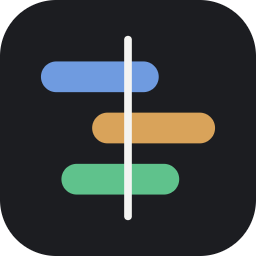

<div align="center">



# ShotSynq

### Free, open-source multicam and audio sync

**Drop in the whole shoot. Get a synced timeline.**

Line up footage from several cameras and separate audio recorders by their sound,<br>
then open the result in Premiere Pro, DaVinci Resolve or Final Cut Pro.

<a href="../../releases/latest"></a>

Version 0.9.0 · [All releases](../../releases)


https://github.com/user-attachments/assets/16e9d0ec-bf21-4b6c-a69e-11fb5f86995c


[Releases](../../releases) · [How it works](#how-sync-works) · [Limitations](#limitations) · [Build from source](#build-from-source)

 

</div>

---

ShotSynq is a free, open-source alternative to PluralEyes and Syncaila. Add the footage from every camera and the files from your audio recorder. ShotSynq matches them by their sound, places every clip on one timeline, and exports it to your editor.

It runs entirely on your computer. Nothing is uploaded, and your original files are never changed.

## From shoot to edit

1. **Add media.** Drag in files or whole card folders, or click **+ Add media**. Files are grouped by device automatically.
2. **Synchronise.** Usually done in about a second. Anything that couldn't be matched goes to a separate tray instead of being guessed at.
3. **Export.** Pick your editor once; ShotSynq remembers it.

| Editor | Export format |
|---|---|
| Adobe Premiere Pro | FCP 7 XML |
| DaVinci Resolve | FCP 7 XML |
| Final Cut Pro | FCPXML 1.10 *(beta)* |

## What ShotSynq handles

- **Cameras and recorders together:** any mix of cameras, phones and audio recorders, as long as they heard the same sound.
- **Different mics:** matching works on the rhythm of the sound, not its tone, so a camera's on-board mic still lines up with a lav or recorder.
- **A whole day of takes:** separate takes are laid out one after another in recording order, using each camera's clock and file numbering.
- **Clips that don't match:** these go to an **Unplaced** tray instead of a made-up position, so the timeline only shows real placements. Right-click to open a clip or show it in File Explorer.
- **Recorder audio:** optionally replace camera (scratch) audio with recorder audio. This only happens where a recorder was actually running, so you never get silent gaps.
- **Device names:** reads the camera model from file metadata where it's available (for example "Canon EOS C70") and names tracks Camera A, Camera B, Recorder.
- **Clips to review:** low-confidence matches are outlined in amber. Click the counters in the status bar to highlight synced, review or unplaced clips.

**Supported files:** anything FFmpeg can read with an audio track, including MP4, MOV, MXF, MTS, AVI, MKV, WAV/BWF, MP3, AAC and M4A.

## How sync works

ShotSynq compares every clip with every clip from the other devices, looking for a stretch of matching sound.

1. **Strong matches become links.** A link is rejected if it would put two clips from the same camera on top of each other, since one camera can't record twice at once.
2. **Positions are solved from all the links together.** Real gaps between recordings are kept.
3. **Clips without a reliable link stay unplaced.** ShotSynq never forces a clip into a position.

On a 49-clip test shoot (two cameras and a TASCAM recorder), every clip PluralEyes synced landed within two frames of PluralEyes' position. ShotSynq also placed a short take PluralEyes missed.

## Limitations

- **Shared sound is required.** Clips are only matched when they recorded the same sound. Timecode-only sync isn't supported yet.
- **No clock-drift correction.** Very long recordings from devices with drifting clocks may slip slightly over time.
- **Windows only** for now.
- **Final Cut Pro export is in beta.** It hasn't been tested in Final Cut Pro yet.
- **The installer isn't code-signed.** Windows SmartScreen will show a warning the first time; choose **More info → Run anyway**.

Always check the synced result before you start cutting.

## Get started

Download the installer from the [Releases page](../../releases/latest) and run it. It installs for your user account only, so no admin rights are needed. FFmpeg is included.

## Build from source

You need Windows 10 or 11 and the following, installed once:

1. **[Microsoft C++ Build Tools](https://visualstudio.microsoft.com/visual-cpp-build-tools/)**, with **Desktop development with C++** ticked.
2. **[Rust](https://rustup.rs)** (stable).
3. **The Tauri CLI:**
   ```
   cargo install tauri-cli --version "^2" --locked
   ```

Then, from the repository folder:

```powershell
# Downloads FFmpeg plus its licence into src-tauri/binaries (needed for the build)
powershell -ExecutionPolicy Bypass -File .\setup-ffmpeg.ps1

cargo tauri dev     # run the app
cargo tauri build   # build the installer
```

The installer is created at `target\release\bundle\nsis\ShotSynq_<version>_x64-setup.exe`.

> **Tip:** run the terminal as a normal user, not as Administrator. Windows blocks drag-and-drop from File Explorer into apps started from an admin terminal.

### Command line

There's a small command-line runner for testing and batch use:

```
cargo run --release -p shotsynq-core --example cli -- tracks.json --export resolve out.xml
```

`tracks.json` lists the files for each device:

```json
[
  {"name": "Camera A", "paths": ["C:/shoot/A/C0001.MXF", "C:/shoot/A/C0002.MXF"]},
  {"name": "Recorder", "paths": ["C:/shoot/audio/ZOOM0001.WAV"]}
]
```

### Project layout

| Path | What's in it |
|---|---|
| `crates/shotsynq-core/src/engine.rs` | The sync engine. Tunable settings are at the top. |
| `crates/shotsynq-core/src/media.rs` | Reading media through FFmpeg and FFprobe, and device detection |
| `crates/shotsynq-core/src/export.rs` | Premiere/Resolve XML and FCPXML export |
| `crates/shotsynq-core/src/session.rs` | Tracks, loading and the state shown in the app |
| `src-tauri/` | The desktop app shell: file dialogs, drag and drop, app commands |
| `ui/` | The interface (HTML, CSS, JavaScript) |

## Licence

ShotSynq is released under the [MIT Licence](LICENSE).

The installer includes unmodified [FFmpeg](https://ffmpeg.org) executables (the gyan.dev build), which are licensed under GPLv3 and run as separate programs. Their licence, exact version and source links ship with the app; open them from **Licences** in the app's sidebar, or see [THIRD-PARTY-NOTICES.txt](THIRD-PARTY-NOTICES.txt).

---

<div align="center">
Made by Rory Marshall
</div>
